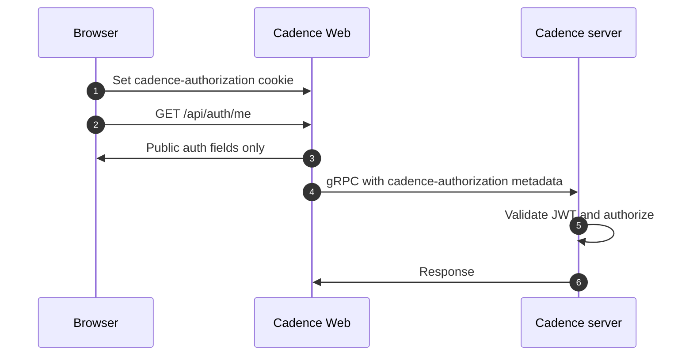

# Cadence Web authentication

How Cadence authorizes API calls, how Cadence Web forwards credentials, how operators configure `disabled` and `jwt`, and how developers add a strategy.

---

## 1. Cadence backend authorization (brief)

The Cadence server ([cadence-workflow/cadence](https://github.com/cadence-workflow/cadence)) decides who may call which APIs and what they may do on each domain. The Web UI does not replace that. It forwards credentials so the server can validate and authorize every gRPC request.

**JWT-based access.** When JWT authorization is enabled on the cluster, the server validates incoming tokens (signature, expiry, and claim shape per deployment config, often via an OAuth authorizer with a public key or JWKS). Typical claims include a subject (`sub`), optional display name (`name`), optional group memberships (`groups` as a string), and an optional `admin` flag. An admin claim usually bypasses domain-level group checks.

**Domain-level rules.** Domains can carry metadata such as read and write group lists, for example `READ_GROUPS` / `WRITE_GROUPS`. Exact names depend on your Cadence version and config. The server compares the caller's groups and admin flag against that metadata to decide read vs write access for that domain.

**Clients and metadata.** gRPC clients send the credential the server is configured to accept. Cadence Web sends the raw JWT in gRPC metadata under the key `cadence-authorization` so the backend can validate and apply policy the same way as other tooling.

For server-side configuration (keys, authorizer settings, TTLs), use the [Cadence GitHub repository](https://github.com/cadence-workflow/cadence), including discussions and release notes for JWT/OAuth authorization.

---

## 2. How auth is implemented in Cadence Web

Cadence Web does not implement a full identity provider and does not verify JWT signatures. It decodes the JWT payload for UX and routing decisions. The Cadence server validates the token and enforces authorization.

Auth is strategy-based. `CADENCE_WEB_AUTH_STRATEGY` is resolved once at server start. Invalid or missing values behave as `disabled`.

| Strategy | Behavior |
| -------- | -------- |
| `disabled` (default) | No login required. No token is read from a cookie or sent to Cadence. Domain/action resolvers treat the user as having full access for UI purposes. |
| `jwt` | Auth is on. A JWT in the `cadence-authorization` HttpOnly cookie is decoded. If valid and not expired, it is attached to gRPC calls. |

Other strategy values may exist in the codebase for specific deployments. This document covers only `disabled` and `jwt` as operator-ready flows. See [Adding a new auth strategy](#5-adding-a-new-auth-strategy) for how to wire another one.

**Cookie and token handling (`jwt`).** The cookie name is `cadence-authorization`. Server-side code reads the cookie, base64-decodes the JWT payload, and validates the shape with a small schema (for example `sub` or `name` required; optional `admin`, `groups`, `exp`). Expired or malformed tokens are dropped. The raw JWT stays on the server in the private auth context. The client only sees public fields via `GET /api/auth/me` (for example `authEnabled`, `groups`, `isAdmin`, `userName`, `id`, `auth.isValidToken`, `auth.expiresAtMs`). The response never includes the token string.

**Backend calls.** When strategy is `jwt` and a valid token is present, gRPC metadata includes `cadence-authorization: <JWT>` so Cadence can authorize the request.

**UI and dynamic config.** `DOMAIN_ACCESS` uses auth context plus domain metadata from the server to compute per-domain access. `WORKFLOW_ACTIONS_ENABLED` combines that with other flags so buttons and actions match what the backend will allow. The nav bar and hooks such as `useUserInfo` / `useAuthLifecycle` handle logout and expiry. `useUserInfo` refetches `GET /api/auth/me` when the window regains focus, so a login or logout in another tab is picked up.

**Login page (`jwt`).** The server layout redirects any request without a valid session to `/login?returnTo=<path and query>`. After a token is saved, the page sends the user back to `returnTo`. Only relative in-app paths are accepted. Anything else falls back to `/`. The page shows a notice banner when `notice` is set:

- `notice=session-expired`: the session cookie was present but the token is invalid or expired, the token expired while the app was open, or another tab ended the session (window-focus refetch).
- `notice=signed-out`: the user chose Log out in this tab.

**API routes (server).**

- `GET /api/auth/me`: public auth snapshot. `Cache-Control: no-store`.
- `POST /api/auth/token`: body `{ "token": "<jwt>" }` (optional `Bearer ` prefix stripped). Sets the HttpOnly cookie.
- `DELETE /api/auth/token`: clears the cookie.

---

## 3. How to use web auth (operators)

### `disabled` (default)

Leave `CADENCE_WEB_AUTH_STRATEGY` unset, or set it to `disabled`. No login page, no auth cookie, no gRPC auth metadata. Use this for local development against an open Cadence cluster.

### `jwt`

1. Set `CADENCE_WEB_AUTH_STRATEGY=jwt`. Restart Cadence Web after changing this value if it was running.
2. Obtain a JWT issued for your Cadence environment (same claims your server expects).
3. Open Cadence Web. You are redirected to `/login`. Paste the JWT there (calls `POST /api/auth/token`).

Logout: use Log out in the user menu (lands on `/login?notice=signed-out`) or `DELETE /api/auth/token`.

Upstream proxies / IdPs can set the cookie directly for the cadence-web origin:

```
Set-Cookie: cadence-authorization=<JWT>; Path=/; HttpOnly; SameSite=Lax; Secure
```

### Example JWT claims (illustrative)

```json
{
  "sub": "alice",
  "name": "Alice Example",
  "groups": "readers auditors",
  "admin": false,
  "iat": 1766080179,
  "exp": 1766083779
}
```

`groups` is a string (space-separated list). Adjust claims to match your Cadence server configuration.

### Quick verification

1. `GET /api/auth/me` shows `authEnabled: true` and, after login, `auth.isValidToken: true`.
2. Domain pages and workflow actions reflect server permissions, not only what the frontend assumes.
3. Removing or expiring the token yields unauthenticated or denied behavior consistent with the backend.

### End-to-end flow (reference)



Note: steps 4 and 5 do not depend on steps 2 and 3. They can run right after setting the cookie in step 1.

---

## 4. Strategy architecture (developers)

Auth behavior is split into two policies selected by `CADENCE_WEB_AUTH_STRATEGY`:

| Side | Type | Selected by |
| ---- | ---- | ----------- |
| Server | `AuthServerPolicy` | `getActiveAuthServerEntry()` loads an entry from `AUTH_SERVER_STRATEGIES_CONFIG` |
| Client | `AuthClientPolicy` | `getAuthClientPolicy(strategy)` loads an entry from `AUTH_CLIENT_STRATEGIES_CONFIG` |

Contracts live in `src/utils/auth/auth.types.ts`. UI and shared hooks must read policy fields (for example `unauthenticatedRemedy`, `supportsSessionRecovery`). Do not compare `authStrategy === '…'`. A widened strategy union fails silently. A missing policy field fails at compile time.

### Selection path

1. `CADENCE_WEB_AUTH_STRATEGY` env → `authStrategy` resolver (`evaluateOn: 'serverStart'`). Invalid or unset values become `disabled`.
2. Boot (`instrumentation.ts`) resolves the active server entry and logs `Auth strategy: <value>`. Startup fails if the policy cannot load.
3. Server call sites use the active policy: `resolveAuthContext`, `getLoginRedirect`, gRPC metadata middleware, cookie helpers.
4. `GET /api/auth/me` returns `authStrategy`. The client looks up `AuthClientPolicy` and runs login, logout, and 401 handling through it.

### File layout

```
src/config/auth/
  auth-strategy-values.config.ts      # Union of strategy names (fork-owned)
  auth-strategy.types.ts
  auth-server-strategies.config.ts    # Server registry (policy + cookieNames)
  auth-client-strategies.config.ts    # Client registry

src/utils/auth/
  auth.types.ts                       # AuthServerPolicy / AuthClientPolicy
  strategies/
    get-active-auth-server-entry.ts
    get-auth-client-policy.ts
    get-declared-auth-cookie-names.ts
    disabled/
    jwt/
    <your-strategy>/
```

### `AuthServerPolicy`

| Method | Role |
| ------ | ---- |
| `resolveAuthContext` | Build private `AuthContext` from the request (cookies/headers). |
| `getGrpcMetadata` | Credential(s) for Cadence gRPC, or `undefined`. |
| `getLoginRedirectIfNeeded` | Layout gate. Redirect URL, or `null` if the request may proceed. |
| `recoverSession` | Pure recovery decision plus optional cookie mutations. The route writes cookies. |
| `getSessionKey` | Stable per-session id for server-only memoization. Never exposed to the browser. |

### `AuthClientPolicy`

| Field / method | Role |
| -------------- | ---- |
| `supportsSessionRecovery` | Whether silent recovery is possible for this strategy. |
| `unauthenticatedRemedy` | `'login'` or `'unavailable'`. Chooses the signed-out page. |
| `login` / `logout` | Browser navigation / session clear. |
| `onUnauthorized` | Whether a 401 should attempt recovery (`true`) or not (`false`). |

### Registry entry (`AuthServerRegistryEntry`)

- `policy`: the policy object, or a lazy `() => import(...).then((m) => m.default)` so unused strategies stay out of the boot path.
- `cookieNames`: `{ exact, prefixes }` allowlist for cookies this strategy may set. Clears are allowed for any name declared by any strategy so logout still works after a strategy change.

### Behavior matrix: `disabled` vs `jwt`

| Concern | `disabled` | `jwt` |
| ------- | ---------- | ----- |
| Login UI | none | `/login` token form |
| Credential | none | raw JWT in `cadence-authorization` cookie |
| gRPC metadata | none | `cadence-authorization: <token>` when valid |
| Layout redirect | never | `/login?returnTo&notice` when invalid |
| Logout | no-op | `DELETE /api/auth/token` then login |
| `onUnauthorized` | `false` | `true` (recover → login redirect) |
| `cookieNames` | empty | exact: `cadence-authorization` |

Copy `disabled` for a minimal / no-flow strategy. Copy `jwt` for cookie + login page + recover/clear.

---

## 5. Adding a new auth strategy

Adding a strategy touches the strategy-values union, both registries, strategy-owned code (and routes only if the strategy has flows), and tests. The registries are exhaustive `Record`s keyed by the strategy-values union, so an unwired value is a compile error. No component needs a new `strategy ===` branch if UI reads policy fields.

### Checklist

1. **Add the name.** Put it in `src/config/auth/auth-strategy-values.config.ts`. The Zod enum and `AuthStrategyConfigValue` type follow from that list.

2. **Implement policies** under `src/utils/auth/strategies/<name>/`:
   - `<name>-server-policy.ts`: default export implementing `AuthServerPolicy` (`import 'server-only'`).
   - `<name>-client-policy.ts`: default export implementing `AuthClientPolicy`.
   - Split helpers as needed (`resolve-*-auth-context`, constants, path builders), following `jwt/` or `disabled/`.

3. **Register the server entry** in `src/config/auth/auth-server-strategies.config.ts`:
   - Prefer a lazy loader: `policy: () => import('...').then((m) => m.default)`.
   - Set `cookieNames` for any cookies the strategy may set (empty if none).

4. **Register the client policy** in `src/config/auth/auth-client-strategies.config.ts`.

5. **Strategy-owned routes / UI** only if the strategy has flows (for example a login page). Keep them outside the `(Home)` gated group when unauthenticated users must reach them.

6. **Optional strategy-specific config.** Add `evaluateOn: 'serverStart'` resolvers and env vars when the strategy needs boot-time settings. Fail loud at startup on misconfiguration.

7. **Tests.** Server policies as `*.node.ts`, client policies as `*.test.ts` / `*.test.tsx`. Cover resolve, redirect, metadata, recover, and login-logout behavior.

8. **Document.** When the strategy is operator-ready, add operator env vars and the login/logout path to this file and the README env table.

### Rules of thumb

- Do not branch shared UI on the strategy string. Add a policy field if you need a new behavior.
- Do not write cookies inside the policy. Return `cookieMutations` / `cleanupMutations` from `recoverSession`, or use the shared cookie helpers from routes, so validation and budget checks stay in one place.
- Gate gRPC credential forwarding on a valid auth context so a forged or missing session never forwards identity to Cadence.
- Reject loudly from `recoverSession` when recovery is unreachable for that strategy (see `disabled`).

### Minimal skeleton

```ts
// src/utils/auth/strategies/my-strategy/my-strategy-server-policy.ts
import 'server-only';

import { type AuthServerPolicy } from '@/utils/auth/auth.types';

const myStrategyServerPolicy: AuthServerPolicy = {
  resolveAuthContext: async (request) => {
    /* build AuthContext from request */
  },
  getGrpcMetadata: (authContext, request) => {
    /* return metadata or undefined */
  },
  getLoginRedirectIfNeeded: (authContext, returnTo, notice) => {
    /* return redirect path or null */
  },
  recoverSession: async (request, ctx) => {
    /* return AuthRecovery (+ cookieMutations if needed) */
  },
  getSessionKey: async (request) => {
    /* stable session id, or undefined */
  },
};

export default myStrategyServerPolicy;
```

```ts
// src/utils/auth/strategies/my-strategy/my-strategy-client-policy.ts
import { type AuthClientPolicy } from '@/utils/auth/auth.types';

const myStrategyClientPolicy: AuthClientPolicy = {
  supportsSessionRecovery: false,
  unauthenticatedRemedy: 'login', // or 'unavailable'
  login(returnTo, notice) {
    /* navigate */
  },
  async logout(options) {
    /* clear session if any, then navigate */
  },
  onUnauthorized: () => false, // true only if recoverSession should run
};

export default myStrategyClientPolicy;
```

Then wire both registries and add the value to `auth-strategy-values.config.ts`. Select it with:

```bash
CADENCE_WEB_AUTH_STRATEGY=my-strategy
```
